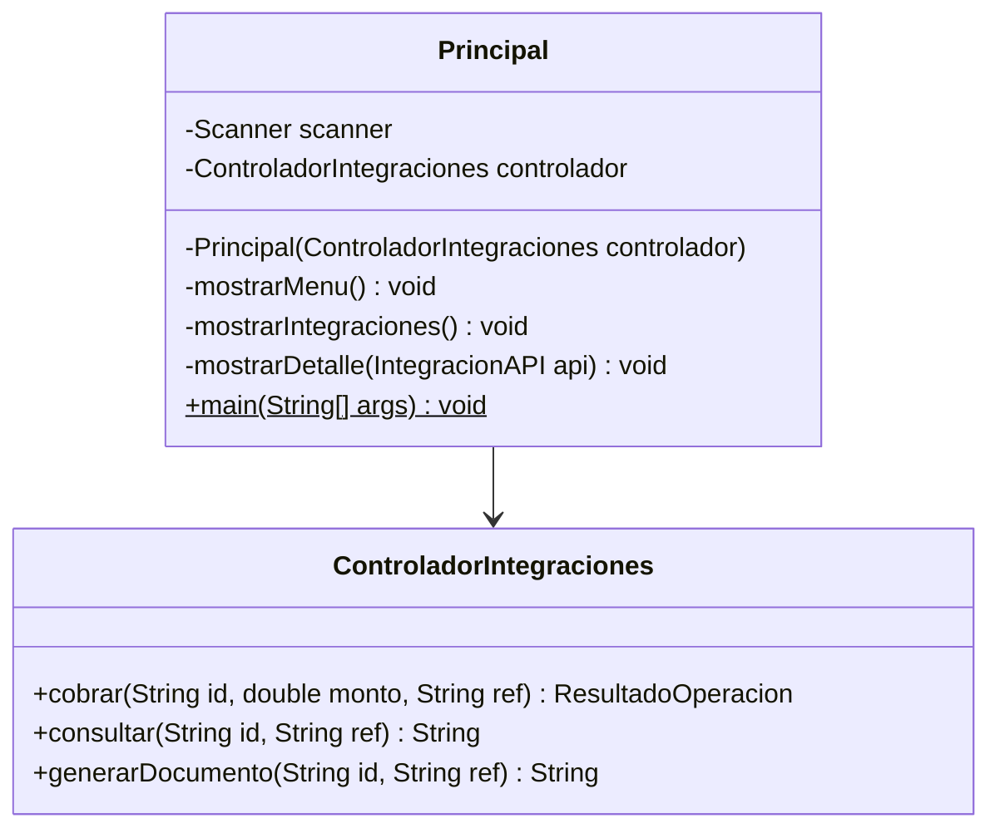

# Precisiones del diseño antes de implementar

Se conservan las clases, contratos, atributos de dominio y firmas completas de las tablas del Word. El UML D abrevia los nombres del motor; se emplean solicitarReintegro, solicitarCobro, solicitarDocumento y solicitarConsulta, según las tablas 2.5.

1. Principal incorpora una referencia privada final al ControladorIntegraciones y un constructor privado que la recibe. Esto permite implementar mostrarMenu() y mostrarIntegraciones() sin parámetros, conservar Scanner como entrada exclusiva de la vista y evitar estado global o catálogos adicionales.
2. ControladorIntegraciones incorpora cobrar(String id, double monto, String ref): ResultadoOperacion, consultar(String id, String ref): String y generarDocumento(String id, String ref): String. Son delegaciones para exponer desde el menú todas las operaciones del motor ya diseñado. No se modifican contratos ni relaciones del dominio.
3. Se añaden únicamente ayudantes privados de validación, lectura y formato en las clases que los necesitan. Las firmas públicas originales permanecen intactas. Los setters void rechazan configuración inválida mediante IllegalArgumentException; las operaciones del checkout devuelven respuestas controladas. La vista captura errores de entrada.
4. La validación del reintegro genérico comprueba primero existencia y datos; después la capacidad. Con datos válidos, logística devuelve IGNORADA incluso si está desconectada. Las operaciones compatibles requieren activa y conectada.
5. Por fidelidad al Word, equals/hashCode usan id, mientras compareTo usa latencia y luego id. El orden natural puede ser inconsistente con equals entre dos objetos del mismo id con latencias distintas; el catálogo impide ids duplicados. No usar estas entidades en TreeSet/TreeMap por identidad ni modificar latencias mientras se ordenan.

Este complemento precisa la conexión de la vista y amplía las delegaciones del controlador; los cuatro UML originales mantienen sus demás relaciones. No se modifica el Word fuente.
